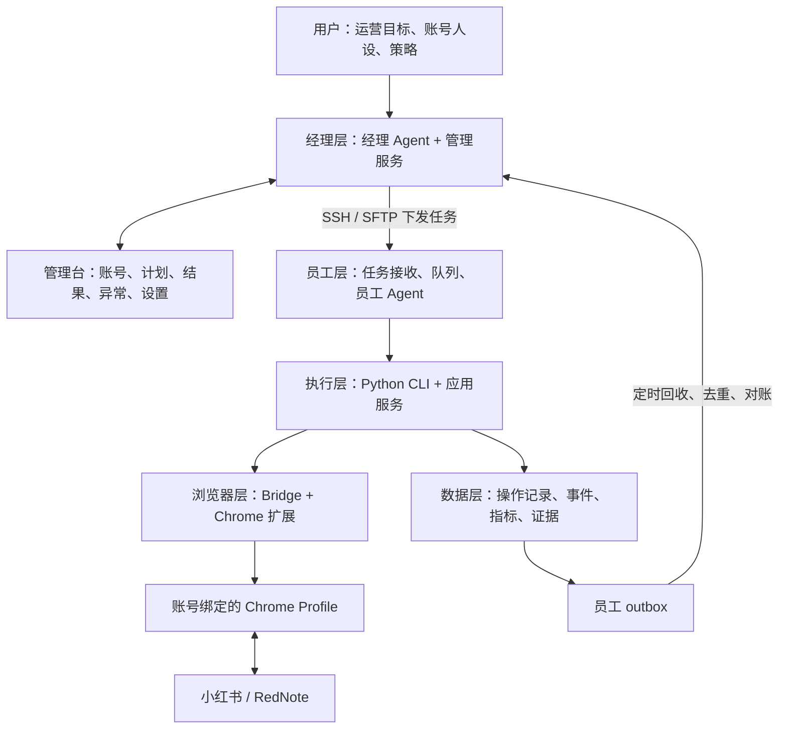

# 9.17日项目梳理

梳理日期：2026-09-17

项目：Mila 小红书运营系统（xiaohongshu-skills）

依据：当前本地项目文档与源码。员工机实际安装版本、在线状态和定时任务生效情况未在本次远程核验。

## 一、项目定位

Mila 是一套由经理 Agent 统一安排、员工 Agent 分机执行、真实浏览器操作、结果集中回收的多账号运营系统。

系统按机器部署，按账号运营。机器提供执行环境，账号是人设、任务、数据和记忆的业务单位。

## 二、整体结构



## 三、五层职责

### 1. 经理层：安排和管理

经理机维护员工机、账号、人设、运营目标与计划，派发任务并汇总执行结果。

- **经理 Agent**：理解运营要求，拆解任务，安排账号执行，核对完成情况。
- **管理台 WebUI**：展示账号、运营规划、执行结果、采集数据和异常，并提供配置入口。任务安排以 Agent 为主。

主要源码：

- `scripts/manager_service.py`：经理端任务与协作服务。
- `scripts/manager_agent_service.py`：运营任务领取、规划、派发与核销。
- `scripts/manager_cli.py`：经理端命令入口。
- `webui/manager-*.js`：管理台各业务界面。

### 2. 员工层：在各台电脑执行

每台员工机具有自己的任务接收与执行环境：

1. 从 `inbox` 接收任务，通过 `wake-task` 唤醒执行。
2. 员工 Agent 领取任务，读取账号人设、知识和任务上下文。
3. 调用本机执行能力，生成结果和证据。
4. 写入 `outbox`，供经理机回收。

同账号串行执行；不同账号按各自状态安排。

主要源码：`scripts/manager_worker_service.py`、`scripts/employee_codex_runner.py`、`scripts/employee_task_cli.py`、`scripts/executor_server.py`。

### 3. 执行层：把运营要求变成具体动作

统一入口是 Python CLI，背后由 `ApplicationService` 组织账号、任务和业务服务。

| 能力 | 内容 |
| --- | --- |
| 账号管理 | 槽位、Chrome Profile、扩展配对、登录身份、换号 |
| 内容发现 | 首页浏览、搜索、笔记详情、评论读取 |
| 主动互动 | 点赞、收藏、评论、关注、私信 |
| 内容发布 | 图文、视频、长文、发布结果回读 |
| 被动运营 | 新增粉丝、获赞、评论、私信采集，以及智能回复 |
| 数据与诊断 | 笔记指标、日报、执行证据、异常诊断和恢复 |

业务服务集中在 `scripts/`，具体平台页面操作集中在 `scripts/xhs/`，平台定义与能力适配集中在 `scripts/platforms/`。

### 4. 浏览器层：复用真实账号环境

基本关系：

```text
账号槽位 → 绑定的 Chrome Profile → 扩展与 Bridge → 平台页面
```

槽位是系统管理账号的稳定单位，关联浏览器环境、平台、绑定 UID、人设和运行配置。

Python 引擎通过 Bridge 与 Chrome 扩展通信，执行页面读取、点击、输入、截图等操作。当前源码适配小红书和 RedNote，各项能力通过平台注册表区分支持情况。

主要源码：`scripts/bridge_server.py`、`scripts/xhs/bridge.py`、`extension/`。

### 5. 数据层：记录执行事实，支持运营对账

| 数据类别 | 用途 |
| --- | --- |
| 配置与计划 | 员工机、账号、人设、目标、调度设置 |
| 执行记录 | 任务、动作、状态、逐项结果、证据 |
| 平台采集 | 粉丝、获赞、评论、私信、已发布笔记指标 |
| 账号记忆 | 长期知识、短期上下文、经验审核、人设版本 |

员工端由 `scripts/operations_db.py` 等模块保存业务记录；经理端通过 `scripts/manager_database.py` 建立汇总查询库。`scripts/manager_sync_service.py` 负责同步，回收后进行去重、统计和目标核销。

## 四、完整任务链路

```text
用户提出运营目标
→ 经理 Agent 拆解并登记账号目标
→ 经理服务生成任务 JSON
→ SSH / SFTP 投递员工机 inbox
→ wake-task 唤醒员工执行
→ 员工 Agent 领取任务
→ CLI / 应用服务调用浏览器能力
→ 平台执行与结果回读
→ 员工保存记录、证据并写入 outbox
→ 经理回收、去重导入
→ 更新运营台与目标完成情况
```

任务收到、Agent 领取、业务完成、回执写出、经理导入是不同阶段。`TASK_ACK` 表示任务接收确认；完成数量需要业务结果和回执支撑。

`READY` 表示账号可调度。`RESULT_UNKNOWN` 表示业务结果仍需核对，应先检查原执行证据和平台实际状态。

## 五、源码目录地图

```text
xiaohongshu-skills/
├─ scripts/           Python 服务、调度、数据、CLI
│  ├─ xhs/            小红书页面操作
│  └─ platforms/      平台定义与能力适配
├─ extension/         Chrome 扩展与浏览器通信
├─ webui/             经理管理台、员工界面
├─ skills/            Agent 的业务操作说明
├─ prompts/           Agent 提示词材料
├─ tests/             自动化测试
├─ docs/              产品需求、协议、验收规范
├─ project-memory/    项目背景、决策和工作记录
└─ package_templates/ 功能包模板
```

正式功能包放在项目外的 `../功能包/`，按业务模块、功能编号和版本管理。

## 六、主要设计关系

- **机器与账号**：机器承载执行环境，账号隔离人设、身份、任务、数据和回复记录。
- **Agent 与执行程序**：Agent 负责理解、规划和判断；Skills 指导能力调用；Python、把这个Bridge 和扩展执行具体动作并留下证据。
- **任务与数据**：任务下发形成执行链，平台回读、员工回执、经理回收与对账形成结果闭环。
- **代码与部署**：本地源码、员工安装版本、服务运行状态和真实业务验收分别记录。

## 七、进一步查阅入口

- `project-memory/README.md`：项目记忆索引。
- `project-memory/01-项目概览.md`：产品与核心对象。
- `project-memory/02-系统架构.md`：执行链与源码入口。
- `project-memory/03-当前状态.md`：阶段记录与待验收事项。
- `docs/PRD.md`、`docs/PRD-TRACEABILITY.md`：产品规则与需求追踪。
- `docs/OPERATIONS-ACCEPTANCE-DATABASE.md`：运营查询与验收口径。
- `docs/DEBUG-WORKFLOW.md`：员工报障、修复与验收流程。
