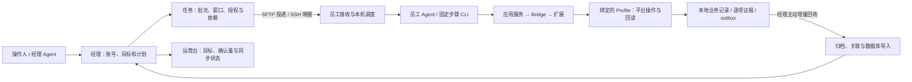

# xiaohongshu-skills

小红书多账号运营系统。经理机负责账号策略、每日计划、分批投递与结果汇总；员工机通过自己的
Chrome Profile、Bridge、Codex 和 Python 程序执行任务，保存平台证据并回传结果。

项目支持本机使用和经理／员工协作，兼容 `SKILL.md` 技能格式的 Agent 可沿技能入口调用程序。
程序包版本为 **0.1.0**，源码采用 **NexaFlow V0.20 职责布局**，工程基线维护在 `main`。

## 从哪里开始

| 目标 | 阅读入口 |
| --- | --- |
| 接手项目、看完整架构和代码功能 | [架构与使用手册](docs/项目框架结构.html) |
| 第一次了解项目 | [新手项目说明](docs/BEGINNER-PROJECT-GUIDE.md) |
| 使用账号和运营台 | [用户指南](docs/USER-GUIDE.md) |
| 配置新经理机和员工机 | [第二套系统部署](docs/SECOND-SYSTEM-DEPLOYMENT.md) |
| 构建、安装员工职责包 | [员工版本部署与验收](docs/V020-WORKER-DEPLOYMENT.md) |
| 找真实源码和角色目录 | [V0.20 职责布局](docs/V020-ROLE-LAYOUT.md) |
| 排查连接、执行与回收问题 | [故障恢复指南](docs/TROUBLESHOOTING.md) |
| 核对产品要求与验收范围 | [需求追踪矩阵](docs/PRD-TRACEABILITY.md) |

下载仓库后，用浏览器打开 `docs/项目框架结构.html`。它是自包含文件，可离线查看，包含角色
阅读路线、全流程详图、通信与数据对照表、代码功能策略表、FAQ、成功与异常任务样例。图支持全屏、缩放、
跨章节搜索、节点定位和返回阅读位置。完整导航见 [文档索引](docs/README.md)。

## 经理与员工怎样协作



任务和结果通过 **SSH/SFTP + inbox/outbox** 交换。经理主动拉取员工结果索引，归档并按执行
编号和结果版本导入。任务回执、员工业务表快照和证据文件分别核对同步状态。

| 通道 | 所在位置 | 职责 |
| --- | --- | --- |
| HTTP `8765` | 经理机或本机控制台 | WebUI、经理 API 和运营查询 |
| `127.0.0.1:8766` | 员工机本机 | 执行服务、本机 API 与队列 |
| `ws://localhost:{bridge_port}` | 员工账号槽位 | Python 与 Chrome 扩展通信；端口沿账号配置，默认分配起点为 9333 |
| SSH / SFTP | 经理与员工之间 | 命令、唤醒、任务、材料、结果与证据传输；连接参数沿机器登记 |

当前经理工作区标识为 `PC023`，业务身份为 `MILA-MANAGER`；已登记员工工作区为
`PC052`、`PC057`、`PC065`、`PC071`、`PC073`。机器编号定位岗位和程序实例，账号槽位隔离
身份、配置和任务。调度按时间窗口、业务依赖、机器串行、批间隔与账号锁放行。

## 当前主要能力

| 能力 | 实现与完成依据 |
| --- | --- |
| 账号环境 | Profile 发现与绑定、槽位、扩展配对、Bridge、UID 绑定和半自动换号 |
| 内容发现 | 首页、搜索、笔记详情、评论与用户资料读取 |
| 浏览与互动 | 首页浏览点赞会话，以及指定笔记评论、回复、点赞、收藏和关注；逐项保存结果 |
| 内容发布 | 图文、视频、长文与文字配图；依据平台提交证据和作品回读确认 |
| 文字配图任务 | Agent 准备编辑器；固定 CLI 读取原任务和授权，填写标题、正文与话题并提交回读 |
| 消息与回复 | 评论／私信采集，结合规则、人设和上下文生成回复，发送后保存平台确认 |
| 计划与调度 | 每日计划、本批新增目标、时间窗口、业务依赖、同机串行和暂停／恢复 |
| 任务恢复 | 网络重连、在途步骤等待、串行队列续接、原执行对账与结果修订 |
| 回收与验收 | outbox 增量回收、版本去重、业务表导入，以及按账号和日期统计确认量 |

浏览点赞批次区分本批目标与全天目标，结算识别 `actual_new_metrics`、`actual_metrics` 等数量
字段。文字配图沿任务提供的标题与话题提交。具体能力和限制沿 [PRD](docs/PRD.md)、追踪矩阵
与对应技能维护；WebUI 展示、Agent 编排和固定程序各自的职责在架构手册中说明。

## 源码在哪里

```text
xiaohongshu-skills/
├─ scripts/                     固定 CLI、服务和开发调用入口
├─ source-layout.json           模块、脚本、资源与真实源码位置映射
├─ webui-layout.json            界面资源映射
├─ ManagerStation/Managers/
│  ├─ AGENTS.md                 经理公共职责
│  └─ PC023/
│     ├─ AGENTS.md               本项目经理职责
│     ├─ function_packages/      经理实现源版本
│     ├─ worker_packages/        经理维护的员工实现源版本
│     ├─ package_relations/      功能目录与版本关系
│     └─ scripts/development/    环境、构建与工程维护工具
├─ WorkerStation/Workers/
│  ├─ AgentWorkers/              员工岗位规则
│  └─ ProgramWorkers/instances/   各机器程序实例定义
├─ deploy/                       员工包构建、安装与基础接入
├─ tests/                        Python 和前端回归
├─ docs/                         产品、架构、使用与部署文档
├─ project-memory/               项目决策与工程上下文索引
├─ package_templates/            功能包模板
├─ pyproject.toml                项目版本和依赖声明
└─ uv.lock                       依赖锁
```

| 职责 | 权威源码位置 |
| --- | --- |
| 经理任务、状态、回收和 WebUI | `ManagerStation/Managers/PC023/function_packages/xiaohongshu-skills/0.1.0/manager/` |
| 员工应用、页面、执行、共用组件和技能 | `ManagerStation/Managers/PC023/worker_packages/xiaohongshu-skills/0.1.0/worker/` |
| Chrome 扩展 | 员工源版本中的 `extension/` |
| 员工机安装版本 | 目标机 `WorkerStation/Workers/ProgramWorkers/packages/` 下对应版本 |

根 `scripts/` 通过 `scripts/_role_layout.py` 读取映射并加载真实实现。修改业务逻辑时进入对应
职责源版本，调用时使用根固定入口。主要模块的功能、策略、作用和源码定位见手册“代码与功能”。

正式业务功能版本由经理 `manager_manifest.json` 的 `paths.formal_function_packages` 定位。
当前功能清单引用仓库外同级“功能包”目录；使用这些正式版本时，另行准备该目录和
`版本清单.json`。正式功能版本与主仓库中的经理／员工职责源版本分别维护。

## 环境与快速开始

主要运行环境为 Windows PowerShell。Python 要求 `>=3.11`，现有 Windows 验证使用 3.12。
开发验证使用 Git、uv 和 Node.js；账号执行使用 Chrome，Agent 执行使用已登录的 Codex，
跨机协作使用 OpenSSH。

### 1. 获取主分支并准备依赖

```powershell
git clone --branch main https://github.com/xiaoquan661/auto-xhs.git C:\auto-xhs\xiaohongshu-skills
Set-Location C:\auto-xhs\xiaohongshu-skills
uv sync --locked
$projectRoot = (Resolve-Path .).Path

uv run python "$projectRoot\scripts\cli.py" --help
uv run python "$projectRoot\scripts\manager_cli.py" --help
```

现有环境也可按用户指南使用 `scripts/bootstrap.ps1 -Prepare`。后续 CLI 使用项目虚拟环境中的
Python，依赖版本沿 `pyproject.toml` 和 `uv.lock` 维护。

### 2. 启动本机或经理控制台

Windows 用户可双击 `start-auto-xhs.cmd`。命令行启动方式为：

```powershell
$projectRoot = (Resolve-Path .).Path
powershell -ExecutionPolicy Bypass -File "$projectRoot\scripts\start-webui.ps1" `
  -ListenAddress 127.0.0.1 -Port 8765
```

浏览器打开 `http://127.0.0.1:8765`。局域网访问按实际网络配置监听地址和入口。
经理状态目录通过 `XHS_MANAGER_HOME` 指定；现有经理机使用 `C:\auto-xhs\manager-state`。

### 3. 完成机器接入与账号准备

1. 机器层：准备 Python 依赖、Codex、SSH/SFTP、执行服务和一致的 inbox/outbox 路径。
2. 账号层：配置固定槽位、绑定 Profile、平台登录、UID 绑定、扩展配对和账号 Bridge。
3. 任务层：明确账号、业务日期、动作与目标，配置授权、计划时点和必要输入，再准备并下发批次。

首次绑定后，日常任务复用槽位身份。更换平台账号时按换号流程核对新绑定。计划草稿可以先保存，
实际执行按当前运行条件检查。具体操作见用户指南与第二套系统部署文档。

### 4. 查看入口和状态

```powershell
uv run python "$projectRoot\scripts\cli.py" account-list
uv run python "$projectRoot\scripts\manager_cli.py" machine --help
uv run python "$projectRoot\scripts\manager_cli.py" daily-plan --help
uv run python "$projectRoot\scripts\cli.py" submit-text-card --help
```

经理通过 Agent／CLI 配置计划，在运营台查看投递、领取、结果和回收。员工接收原任务并等待
调度放行，由 Agent 调用固定步骤 CLI；应用服务通过 Bridge 和扩展操作绑定的 Profile，结果
写入本地业务存储和 outbox。

## 怎样判断任务完成

| 记录 | 能确认的阶段 | 接着核对 |
| --- | --- | --- |
| `TASK_ACK / ACCEPTED` | 员工服务已接收并建立执行记录 | 队列等待原因和实际领取进度 |
| `agent_claimed / claimed.json` | 员工 Agent 已读取并领取原任务 | 步骤输出和平台动作 |
| `TASK_RESULT` 与任务终态 | 本次执行已按能力规则结算 | 本批目标、逐项平台证据和确认数量 |
| `RESULT_ACK / result_collected` | 经理已记录该版本回收入库 | 业务表、证据文件和页面快照的同步状态 |
| 业务确认量 | 动作具备对应能力的计数证据 | 按机器、账号、日期和结果版本验收 |

执行结果包括 `SUCCESS`、`PARTIAL_SUCCESS`、`FAILED`、`BLOCKED`、`CANCELLED` 和
`RESULT_UNKNOWN`。结果待核对时沿原 `task_id`、`dispatch_id`、`remote_execution_id` 查看步骤、
平台与回执，必要时追加同一执行的新结果版本。

发布提交和平台审核进度分别记录；互动核对实际变化及平台回读；私信核对己方消息和回复确认
记录。不同动作的判定 FAQ 和异常处理样例见架构手册。

## 更新与员工部署

本机源码更新使用 Git `main`；员工运行版本由经理构建、传输、安装并核对实际加载路径。

1. 在分支维护权威源码，运行相关回归后通过 PR 合入 `main`。
2. 使用 `deploy/build-worker-layout.py` 构建指定机器的员工版本。
3. 按部署文档备份并安装对应布局，核对固定入口的实际导入位置和服务健康。
4. 验证接收、Agent 领取、outbox 结果和经理导入，再按能力完成业务验收。

`deploy/employee-bootstrap/` 提供基础接入脚本，配套源码 ZIP 和离线依赖需按当前版本准备。
新机器还需登记岗位、manifest、程序实例及运行路径，完整步骤见部署文档。扩展代码更新后
递增 manifest 版本，在目标 Profile 重载，并以 Bridge 回报的实际版本验收。

## 工程版本与本地存储

Git 维护源码、通用配置与合同、依赖锁、测试、技能、文档和构建工具。运营数据库、登录会话、
浏览器 Profile、运行状态、素材和业务资产按机器保存在业务目录。

| 本地内容 | 常用位置 |
| --- | --- |
| 经理配置、计划、回执和数据库 | `XHS_MANAGER_HOME`；现有经理为 `C:\auto-xhs\manager-state` |
| 员工协议状态 | 员工用户的 `.xhs\auto-xhs\manager-worker` |
| 员工收件与发件目录 | 机器登记中的 `task_inbox_root`、`task_outbox_root` |
| 账号环境、Profile 与配对 | 各员工账号配置和对应 Chrome Profile |
| 业务素材 | 经理 manifest 和任务输入中指定的实际路径 |

手册历史案例用于解释任务链与判定过程，设备和账号的当前状态以实际回读为准。
程序包版本、职责布局、功能版本和机器实际安装版本分别登记。

## 开发与验证

在项目根执行：

```powershell
uv sync --locked
uv run ruff check .
uv run pytest
```

提交前用 `uv run ruff format` 格式化本次修改的 Python 文件。前端使用 Node.js 内置测试：

```powershell
$projectRoot = (Resolve-Path .).Path
$frontTests = Get-ChildItem "$projectRoot\tests\test_*.cjs" | ForEach-Object { $_.FullName }
node --test $frontTests
```

模拟测试验证程序合同；新机安装、账号就绪和平台业务分别记录实际验收。工程规则见
[AGENTS.md](AGENTS.md)，技能入口见 [SKILL.md](SKILL.md)，上下文入口见
[项目记忆库](project-memory/README.md)。

## License

[MIT](LICENSE)
