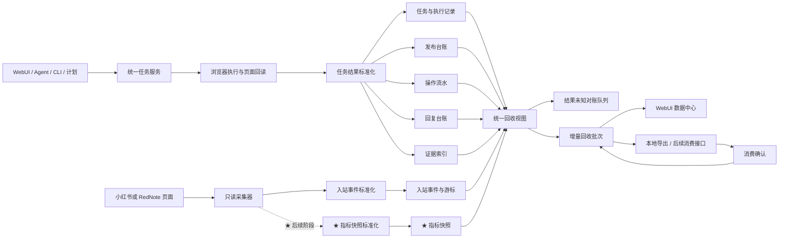

# AUTO-XHS 执行机数据回收层实施方案

文档状态：`AUTOMATED_TESTED_PARTIAL`
版本：`v1.2`
日期：`2026-08-26`
适用项目：`xiaohongshu-skills / auto-xhs`

## 1. 文档目标

本文定义 AUTO-XHS 执行机的数据回收层，包括数据产生、标准化、保存、增量整理、证据关联、结果对账、查询和交付接口。

数据回收层解决的不是“把数据库文件复制出去”，而是把每次运营过程整理成可判断、可追踪、可重复读取的业务记录，使 WebUI、Agent、CLI 和后续跨电脑消费端使用同一套结果语义。

本阶段优先交付三项用户可直接看到的数据效果：

1. 发布台账：每篇已发布帖子都有记录；
2. 操作流水：点赞、取消点赞、收藏、取消收藏、评论、关注等每次实际操作都有记录；
3. 回复台账：私信回复和评论回复都有原事件、回复内容、执行结果及回读记录。

证据索引、结果对账、采集游标和增量批次用于支撑以上三本业务台账稳定运行。

> ★ 后续阶段：帖子运营数据、指标历史、增量分析和运营报告保留设计接口，不进入当前开发与验收范围。本文中带 `★` 的内容均按此规则处理。

## 实施状态（2026-08-26）

当前已完成三本业务台账的首期实现：

- 发布任务结算后写入发布帖子记录，并保存任务、账号、UID、帖子标识、地址和页面回读结果；
- 点赞、收藏、评论、关注、发布和回复等执行结果写入统一操作记录；
- 私信回复和评论回复写入统一回复记录，并关联原内容、实际回复、草稿、任务、操作记录和回读结果；
- 提供数据回收汇总、发布帖子、操作记录和回复记录查询 API；
- WebUI 增加“数据回收”页面，展示三本台账及状态汇总；
- 数据库迁移、服务、应用接口、HTTP 路由和 WebUI 脚本已完成自动化验证。

当前交付状态：

| 阶段 | 状态 | 本次范围 |
|---|---|---|
| D1 数据契约和数据库迁移 | `AUTOMATED_TESTED` | 三本台账及操作记录扩展字段 |
| D2 三本业务台账 | `AUTOMATED_TESTED` | 发布、操作、私信回复和评论回复结算 |
| D3 增量回收批次 | `PENDING` | 水位、批次冻结、导出和消费确认 |
| D4 WebUI 数据中心 | `AUTOMATED_TESTED_PARTIAL` | 汇总与三本台账查询；批次和对账随 D3 继续实现 |
| D5 ★ 运营指标与报告 | `LATER` | 后续阶段 |

自动化测试通过不替代真实账号验收。当前尚未执行发布、互动或回复等真实平台操作，`REAL_DEVICE_VERIFIED` 保持待验收。

跨电脑调度可在后续直接消费本文定义的批次和接口，不改变执行机内部数据模型。

### 1.1 三本业务台账的最终效果

| 台账 | 用户在 WebUI 中看到什么 | 系统何时写入 |
|---|---|---|
| 发布台账 | 账号、标题、帖子 ID、帖子地址、发布时间、发布结果和页面回读 | 发布任务结算时创建帖子记录 |
| 操作流水 | 账号、操作类型、目标帖子或用户、执行时间、成功/失败/结果未知、错误原因、页面回读 | 每个实际操作步骤结算时追加一条记录 |
| 回复台账 | 回复渠道、原评论或私信、回复内容、目标用户或会话、发送时间、发送结果、页面回读 | 评论回复或私信回复每次执行结算时追加一条记录 |
| ★ 帖子运营数据 | 最新运营数据、历史快照、相比上次的增量和最近采集时间 | 后续阶段按帖子追加指标快照 |

三本台账记录成功、失败、阻塞和结果未知，不只保存成功项。

## 2. 需求依据与成功标准

本方案对应项目需求中的 `DATA-01`、`DATA-02`、`DATA-03`，并为执行结果回收提供本地数据基础。

完成后的核心成功标准是：

- 每个任务均可追溯到创建来源、目标账号、执行步骤、逐项结果和最终状态；
- `SUCCESS` 必须关联有效页面或平台回读；
- `RESULT_UNKNOWN` 必须进入对账队列，不能被当作成功或自动重试依据；
- 同一评论、私信和结果批次重复读取时只形成一份业务记录；
- 服务重启后可从已确认游标继续采集，不漏掉已保存记录；
- 已形成的发布记录、操作流水和回复记录采用追加方式保存；
- 数据消费者可确认已经接收的批次，执行机可准确展示待回收、已导出和已确认范围；
- 任务、入站事件、操作事件和诊断各自保持清晰边界，同时可以通过 ID 关联查询。
- 发布帖子可以从发布记录下钻到来源内容、草稿版本、发布任务和页面回读；
- 点赞、收藏、评论、关注等操作可以按账号、动作、目标和时间查询；
- 私信回复和评论回复可以关联原入站事件、回复文本、确认记录、执行任务和回读结果。

★ 后续阶段成功标准：未采到的指标保持空值并说明原因；指标快照和原始报告追加保存；发布帖子可查看历次运营指标。

## 3. 当前实现基线

### 3.1 已有数据能力

| 数据域 | 当前实现 | 当前存储 | 可复用能力 |
|---|---|---|---|
| 任务与最小结果 | `product_store.py`、`task_service.py` | `product-state.json` | 任务来源、账号槽位、能力、风险等级、状态、结果摘要、错误码、处理建议 |
| 任务操作记录 | `task_service.record_event()` | `product-state.json` | 任务终态、目标、结果对象 |
| 结构化操作事件 | `operation_event_service.py` | `operations.db` | 平台、能力、目标、结果状态、平台结果和回读 JSON |
| 入站事件 | `inbound_event_service.py` | `operations.db` | 评论或私信事件保存、自然键去重、处理状态、关联任务 |
| 采集游标 | `collector_service.py` | `operations.db` | 分账号、分采集器保存游标、成功时间、尝试时间和错误 |
| ★ 指标快照 | `metric_service.py` | `operations.db` | 后续阶段复用账号与笔记指标、历史序列、相邻快照增量和空值保留 |
| 诊断导出 | `diagnostic_export.py` | 本地 JSON 文件 | 敏感字段移除、诊断信息本地导出 |
| 查询接口 | `application_service.py`、`web_server.py` | HTTP API | 当前复用入站事件、操作事件和诊断导出；★ 指标接口后续接入 |

### 3.2 需要补齐的回收层能力

当前实现能够产生和查询多类数据，但还缺少统一交付闭环：

| 缺口 | 影响 | 本方案目标 |
|---|---|---|
| 任务数据分布在 JSON 与 SQLite | 无法用一个稳定游标完整读取 | 增加统一回收视图和导出适配器 |
| 没有证据实体和证据索引 | 页面回读只能嵌在结果 JSON 中 | 建立 `evidence_items` 并关联任务、操作和文件 |
| 没有结果批次和消费确认 | 无法判断哪些数据已经被取走 | 建立 `export_batches`、批次明细和确认状态 |
| 没有结果未知对账实体 | `RESULT_UNKNOWN` 只能靠人工查看任务 | 建立 `reconciliation_cases` 和处理状态 |
| 操作事件缺少稳定幂等键 | 重复结算可能写入重复操作记录 | 以任务、执行尝试和步骤序号形成唯一业务键 |
| 平台字段已加入部分表，但唯一约束和查询仍主要按账号 | 多平台同名事件或游标可能冲突 | 唯一键和查询条件统一加入 `platform` |
| ★ 指标扩展 | 现有快照与相邻增量后续扩展采集质量、报告版本和修正关系 | 后续阶段增加数据状态、报告及修订记录 |
| 发布结果没有独立帖子台账 | 无法稳定列出已发布帖子 | 建立 `published_posts`，关联发布任务、帖子标识和页面回读；★ 指标快照后续挂接 |
| 回复结果主要分散在入站事件、任务和操作事件 | 无法直接查询一条评论或私信最终回复了什么 | 建立 `reply_records`，形成原事件到回复结果的完整关联 |
| WebUI 没有数据回收工作区 | 无法集中查看积压、批次和对账项 | 增加本地数据中心 |

## 4. 业务边界

数据回收层按五类对象独立建模。

### 4.1 主动任务结果

主动任务由 WebUI、Agent、CLI 或计划创建。回收内容包括：

- 任务主记录及状态转换；
- 每次执行尝试；
- 每个实际操作步骤；
- 批量任务的逐项目标结果；
- 页面或平台回读；
- 错误码、处理建议和人工处理需求。

任务终态是任务级判断，逐项结果是目标级判断。批量任务即使整体为 `PARTIAL_SUCCESS`，每个目标仍须有独立结果。

### 4.2 被动入站事件

平台评论、私信和通知首先保存为入站事件，再根据规则或人工操作关联任务。事件采集本身不代表回复任务已执行。

回收内容包括：

- 平台事件标识和自然去重键；
- 事件发生时间与发现时间；
- 原始上下文和分类；
- 当前处理状态；
- 由该事件产生的草稿、确认、任务和最终操作结果；
- 对应采集器游标。

### 4.3 ★ 后续阶段：运营指标

指标采用时间快照，不覆盖历史值。账号和笔记是首期实体，后续可增加内容来源、发布批次和运营活动。

回收内容包括：

- 采集对象、采集时间和数据来源；
- 点赞、收藏、评论、分享、粉丝、关注、浏览、曝光和作品数；
- 每个字段的数据状态和缺失原因；
- 两个有效快照之间的增量；
- 采集任务、账号槽位和平台关联。

### 4.4 证据与诊断

业务证据用于支持结果判断，诊断用于解释运行环境和故障，两者分别保存、分别展示。

业务证据包括：

- 页面回读字段；
- 平台返回的稳定对象 ID 或状态；
- 必要的页面截图；
- 发布、评论、私信、点赞等动作的结果定位信息；
- 批量任务逐项目标的回读。

诊断包括 Bridge、扩展、页面拦截、404、NetLog 和系统健康信息。诊断不能单独证明平台业务操作成功。

### 4.5 回收批次

回收批次是数据消费者读取增量数据的交付单位。批次只引用已经落库的数据，不重新解释任务结果，也不改变原记录。

批次包含：

- 本批次的数据范围和创建时间；
- 各类记录数量；
- 结构版本和产品版本；
- 发布台账、操作流水、回复台账、任务、入站事件、指标、证据及对账项；
- 消费确认状态和确认时间。

### 4.6 运行上下文与内容链

任务结果还需要关联任务发生时的运行上下文和内容版本，避免只看到“成功”而无法确认在哪台机器、哪个账号、使用哪一版内容完成。

回收内容包括：

- 执行机编号、角色、主机别名、程序版本和健康观察时间；
- 账号槽位、平台账号 ID、核验 UID、Bridge 端口和 Profile 引用；
- 来源平台、来源内容 ID、来源地址、作者、发布时间、文案和素材引用；
- 粘贴到目标账号后的草稿修订版本；
- 草稿确认、一次性确认的消费状态；
- 本地导出或后续跨电脑传输记录。

浏览器目录等本地运行字段可在执行机业务库中保存，但导出时仅按消费用途提供必要字段。连接私密信息不进入业务回收记录。

## 5. 总体架构



### 5.1 分层职责

| 层级 | 职责 | 约束 |
|---|---|---|
| 数据产生层 | 当前执行任务、读取事件；★ 后续采集指标 | 不直接组织跨电脑结果文件 |
| 标准化层 | 统一时间、平台、账号、状态、错误和数据质量字段 | 不修改真实业务结果 |
| 持久化层 | 事务保存任务、事件、游标、快照和证据引用 | 原始记录追加保存 |
| 对账层 | 识别缺失回读、部分结果和结果未知 | 不自动重做平台写操作 |
| 批次层 | 按游标形成增量批次并管理确认 | 重复读取返回同一业务记录 |
| 展示与消费层 | WebUI 查询、本地导出、后续跨电脑消费 | 只通过稳定接口读取 |

## 6. 统一数据契约

### 6.1 所有业务记录的公共字段

| 字段 | 类型 | 说明 |
|---|---|---|
| `record_id` | string | 记录唯一 ID |
| `record_type` | enum | `machine_observation`、`account_runtime_snapshot`、`source_content`、`draft_revision`、`approval`、`published_post`、`task`、`task_attempt`、`operation_event`、`inbound_event`、`reply_record`、`evidence`、`reconciliation_case`、`transfer`；★ 后续增加 `metric_snapshot`、`report` |
| `schema_version` | integer | 数据契约版本 |
| `machine_id` | string | 产生记录的执行机编号 |
| `account_slot` | string/null | 本机账号槽位 |
| `platform` | string | `xiaohongshu` 或 `rednote` |
| `created_at` | datetime | 记录创建时间，统一使用带时区 ISO 8601 |
| `observed_at` | datetime/null | 页面或平台实际观察时间 |
| `data_status` | enum | `OBSERVED`、`MISSING`、`FAILED` |
| `missing_reason` | string/null | 未取得数据时的真实原因 |
| `source_type` | string | 数据产生来源 |
| `source_record_id` | string/null | 上游记录 ID |

`data_status` 的判断规则：

- `OBSERVED`：页面或平台明确读取到值，包括真实业务 `0`；
- `MISSING`：该字段在本轮没有可用来源，例如页面未展示、对象尚未成熟；
- `FAILED`：采集动作已执行，但因页面、连接或解析错误未取得结果。

当值为 `0` 时，可增加 `zero_semantics`：

- `BUSINESS_ZERO`：真实业务零；
- `DENOMINATOR_ZERO`：比率计算的分母为零；
- `FILTERED_EMPTY`：筛选后结果集为空。

### 6.2 运行与内容上下文

| 数据对象 | 主要字段 | 产生时机与用途 |
|---|---|---|
| `machine_observations` | `machine_id`、`machine_role`、`host_alias`、`installed_version`、`actual_version`、`health_state`、`observed_at` | 本地服务启动、健康检查和任务结算时保存，用于说明数据由哪个运行实例产生 |
| `connection_observations` | `machine_id`、`connection_type`、`connection_state`、`last_seen_at` | 连接健康检查时保存；后续 SSH 接入时可记录地址别名、端口和用户标识，不保存私密凭据 |
| `account_runtime_snapshots` | `account_slot`、`platform`、`account_id`、`verified_uid`、`bridge_port`、`chrome_user_data_dir`、`chrome_profile_directory`、`runtime_state`、`observed_at` | Profile 绑定、身份核验、任务开始和任务结算时保存，形成任务当时的身份快照 |
| `source_contents` | `source_platform`、`source_content_id`、`source_url`、`source_author`、`source_published_at`、`source_text`、`source_collect_status` | 跨平台采集任务建立和页面读取时保存 |
| `source_media_items` | `source_content_id`、`media_type`、`source_url`、`local_path`、`collect_status`、`missing_reason` | 素材发现和下载时逐项保存，不用一个布尔值概括全部素材 |
| `content_draft_revisions` | `draft_id`、`revision`、`paste_revision`、`target_account_slot`、`title`、`body`、`media_item_ids`、`created_at` | 初次粘贴和每次人工修改时追加保存 |
| `approvals` | `approval_id`、`draft_id`、`revision`、`state`、`confirmed_at`、`consumed_at` | 确认创建、失效、消费和任务结算时保存 |
| `transfer_records` | `transfer_id`、`transfer_type`、`batch_id`、`remote_path`、`state`、`started_at`、`finished_at` | 本地导出时记录；后续传输接入后保存交付状态 |

来源内容、草稿修订、确认、发布任务和平台结果通过以下关系串联：

```text
source_content
-> source_media_items
-> content_draft_revision
-> approval
-> publish_task
-> operation_event
-> evidence_item
-> ★ metric_snapshot（后续阶段）
```

`source_content_id` 和 `draft revision` 必须进入发布任务参数或关联表，确保发布结果能够追溯到准确的来源版本，而不是只关联最新草稿。

### 6.3 三本业务台账

#### 6.3.1 发布台账 `published_posts`

发布任务通过页面回读完成结算后创建或更新帖子记录。帖子记录同时预留后续运营指标采集的对象入口。

| 字段 | 说明 |
|---|---|
| `published_post_id` | 本地发布记录 ID |
| `publish_task_id`、`operation_event_id` | 发布任务与发布操作记录 |
| `account_slot`、`verified_uid`、`platform` | 发布身份 |
| `draft_id`、`draft_revision`、`source_content_id` | 实际发布的内容版本与来源 |
| `platform_post_id` | 页面或平台回读得到的帖子 ID |
| `stable_url` | 可稳定访问的帖子地址 |
| `title`、`content_type` | 标题和图文、视频或长文类型 |
| `published_at` | 平台发布时间或确认发布时间 |
| `result_state` | `SUCCESS`、`FAILED`、`RESULT_UNKNOWN` 等真实结果 |
| `readback_state`、`evidence_ids` | 页面回读与证据 |
| ★ `metrics_collection_state` | 后续阶段使用：`READY`、`COLLECTING`、`BLOCKED` |
| ★ `latest_metrics_at` | 后续阶段使用：最近一次运营数据采集时间 |

处理规则：

- 发布任务进入终态即形成发布记录，包括失败和结果未知；
- ★ 后续阶段仅将回读确认的帖子加入运营指标采集队列；
- `platform_post_id` 或稳定地址暂时无法取得时保持缺失状态，继续保留发布记录和回读缺口；
- ★ 每次指标采集追加 `metric_snapshots`，不覆盖上一轮数据；
- ★ WebUI 后续展示最新值、历史曲线和相邻有效快照增量。

★ 后续阶段帖子运营数据包括：点赞、收藏、评论、分享、浏览、曝光或播放。页面未提供的字段保持为空并说明原因。

#### 6.3.2 操作流水 `operation_events`

每个真实页面动作形成一条操作记录。首期动作包括：

```text
publish
like / unlike
favorite / unfavorite
comment
follow / unfollow
```

操作流水至少展示：账号、动作、目标类型、目标 ID、目标地址、执行时间、结果状态、错误码、结果摘要、页面回读和证据。

批量任务按目标逐条写入。例如一次任务点赞 5 篇帖子，应产生 5 条独立操作记录；任务汇总只负责统计这 5 条记录。

#### 6.3.3 回复台账 `reply_records`

评论回复和私信回复使用统一回复记录，渠道字段区分 `COMMENT_REPLY` 与 `PRIVATE_MESSAGE_REPLY`。

| 字段 | 说明 |
|---|---|
| `reply_record_id` | 回复记录 ID |
| `channel` | `COMMENT_REPLY` 或 `PRIVATE_MESSAGE_REPLY` |
| `account_slot`、`verified_uid`、`platform` | 回复身份 |
| `inbound_event_id` | 原评论或原私信事件 |
| `conversation_id`、`thread_id` | 私信会话或评论线程标识 |
| `original_message_id`、`original_content` | 被回复对象和原内容 |
| `target_user_id`、`target_user_name` | 回复对象 |
| `reply_text` | 实际发送的回复内容 |
| `draft_id`、`draft_revision`、`approval_id` | 草稿和确认关联 |
| `reply_task_id`、`operation_event_id` | 执行任务和操作记录 |
| `sent_at` | 实际发送或尝试发送时间 |
| `result_state`、`error_code` | 执行结果 |
| `readback_state`、`evidence_ids` | 会话或评论区回读与证据 |

处理规则：

- 草稿生成不创建“已回复”结果，实际执行结算时才写入回复台账；
- 修改后的最终回复文本按对应草稿修订保存；
- 回复失败同样保留记录，便于查看原因；
- 发送后无法回读时记录 `RESULT_UNKNOWN` 并进入对账队列；
- 同一个入站事件可以有多次人工处理记录，但每次发送尝试必须有独立 `attempt_id`；
- WebUI 默认按最近回复时间展示，并可按账号、渠道和结果筛选。

### 6.4 任务主记录 `tasks`

在现有任务字段基础上补充：

| 字段 | 说明 |
|---|---|
| `task_id` | 任务唯一 ID |
| `source_type` | `user`、`codex`、`schedule`、`platform_event` |
| `source_event_id` | 被动任务的来源事件 |
| `parent_task_id` | 工作流或批次父任务 |
| `machine_id` | 执行机编号 |
| `target_machine_id` | 任务指定的执行机编号；本地任务默认等于当前 `machine_id` |
| `dispatch_id`、`remote_execution_id` | 后续跨电脑派发与远端执行关联；本地阶段允许为空 |
| `account_slot`、`platform` | 执行身份 |
| `capability`、`operation` | 能力和具体操作 |
| `risk_level` | 风险等级 |
| `state` | 当前任务状态 |
| `created_at`、`started_at`、`finished_at` | 生命周期时间 |
| `result_summary` | 最小可读结果摘要 |
| `error_code` | 稳定错误码 |
| `recommended_action` | 下一步处理建议 |
| `readback_state` | `VERIFIED`、`NOT_REQUIRED`、`MISSING`、`CONFLICTED` |
| `latest_attempt_no` | 最近一次执行尝试序号 |

### 6.5 执行尝试 `task_attempts`

每次真正领取并执行任务时创建一条尝试记录：

| 字段 | 说明 |
|---|---|
| `attempt_id` | 尝试记录 ID |
| `task_id`、`attempt_no` | 任务和递增尝试序号 |
| `claimed_at`、`started_at`、`finished_at` | 尝试时间 |
| `executor_instance_id` | 本地服务实例 ID |
| `state` | 尝试终态 |
| `error_code`、`result_summary` | 本次尝试结果 |
| `readback_state` | 本次回读状态 |

唯一约束：`task_id + attempt_no`。

### 6.6 操作事件字段与幂等规则

操作事件表示一个可独立判断的实际步骤，例如“向第 3 个收件人发送私信”或“对指定笔记点赞”。

新增或统一字段：

- `operation_event_id`；
- `task_id`、`attempt_id`、`action_seq`；
- `account_slot`、`platform`、`capability`；
- `action`、`target_type`、`target_id`；
- `started_at`、`finished_at`；
- `result_state`；
- `error_code`、`recommended_action`；
- `platform_result`；
- `readback`、`readback_state`；
- `evidence_ids`。

唯一约束：`task_id + attempt_id + action_seq`。批量任务必须以操作事件保存逐项结果，不能只保存一个汇总数字。

### 6.7 入站事件 `inbound_events`

保留现有字段并修订唯一约束：

`account_slot + platform + event_type + platform_event_id`

对外数据契约同时输出 `natural_key`，其值由上述稳定业务字段组成，消费端不需要根据事件正文判断重复。

处理状态统一为：

```text
NEW -> CLASSIFIED -> TASK_CREATED -> HANDLED
                    \-> IGNORED
                    \-> NEEDS_REVIEW
```

采集器只负责创建或更新事件发现信息，不直接执行回复。

### 6.8 采集游标 `collector_cursors`

唯一约束调整为：

`account_slot + platform + collector_type`

字段包括：

- `cursor_value`：平台游标或本地水位；
- `last_seen_time`：最近已观察事件时间；
- `last_attempt_time`：最近采集尝试；
- `last_success_time`：最近成功落库；
- `last_error_code`、`last_error_summary`；
- `records_seen`、`records_created`、`records_deduplicated`；
- `checkpoint_record_id`：最近一次已提交记录。

游标只能在业务记录成功提交后推进。采集失败时保留上一次成功游标。

### 6.9 ★ 后续阶段：指标快照 `metric_snapshots`

现有账号、实体、时间和来源唯一约束应加入平台：

`account_slot + platform + entity_type + entity_id + collected_at + source`

现有库字段 `captured_at` 在统一契约中映射为 `collected_at`。每条快照使用 `metrics` 保存指标字段集合，并为集合中的每个字段记录数据状态。

每个指标字段同时具有值和数据状态。例如：

```json
{
  "name": "views",
  "value": null,
  "data_status": "MISSING",
  "missing_reason": "SOURCE_NOT_AVAILABLE"
}
```

增量只在前后两个快照的该字段均为 `OBSERVED` 时计算；任一端缺失时增量保持空值。

### 6.10 证据索引 `evidence_items`

| 字段 | 说明 |
|---|---|
| `evidence_id` | 证据 ID |
| `task_id`、`attempt_id`、`operation_event_id` | 业务关联 |
| `evidence_type` | `PAGE_READBACK`、`PLATFORM_OBJECT`、`SCREENSHOT`、`DIAGNOSTIC_REFERENCE` |
| `captured_at` | 证据取得时间 |
| `source_url` | 可用时记录页面地址 |
| `local_path` | 本地文件相对路径 |
| `mime_type` | 文件类型 |
| `summary` | 人可读说明 |
| `result_support` | 支持的结果判断 |
| `data_status`、`missing_reason` | 证据可用性 |

证据索引不保存 Cookie、验证码、连接凭据或完整敏感页面数据。截图和诊断文件按本地保留策略管理，业务记录只保存相对引用。

### 6.11 对账项 `reconciliation_cases`

以下情况自动创建对账项：

- 任务或操作进入 `RESULT_UNKNOWN`；
- 批量任务汇总与逐项结果不一致；
- 任务标记成功但缺少要求的页面回读；
- 页面回读与平台返回结果冲突；
- 服务中断时存在可能已经发生的平台写入。

字段包括：

- `case_id`、`task_id`、`operation_event_id`；
- `reason_code`、`opened_at`；
- `state`：`OPEN`、`REVIEWING`、`RESOLVED`；
- `required_check`；
- `resolution`：`CONFIRMED_SUCCESS`、`CONFIRMED_FAILED`、`REMAINS_UNKNOWN`；
- `resolution_evidence_ids`；
- `resolved_at`、`resolved_by`。

对账结果追加为新的决议记录，不覆盖原任务当时的观察事实。

### 6.12 回收批次 `export_batches`

| 字段 | 说明 |
|---|---|
| `batch_id` | 批次 ID |
| `schema_version`、`product_version` | 数据与程序版本 |
| `machine_id` | 来源执行机 |
| `range_start`、`range_end` | 本批次增量范围 |
| `created_at`、`exported_at`、`acknowledged_at` | 批次生命周期 |
| `state` | `BUILDING`、`READY`、`EXPORTED`、`ACKNOWLEDGED`、`FAILED` |
| `record_counts` | 各类记录数 |
| `cursor_after` | 消费成功后的水位 |
| `last_error_code`、`last_error_summary` | 批次错误 |

批次明细表 `export_batch_items` 使用 `batch_id + record_type + record_id` 唯一约束，保证重复创建和重复读取不会重复加入业务记录。

## 7. 结果语义与证据要求

| 结果状态 | 业务含义 | 最低证据要求 | 后续处理 |
|---|---|---|---|
| `SUCCESS` | 操作已完成且回读确认 | 正向页面或平台回读 | 可进入统计和报告 |
| `PARTIAL_SUCCESS` | 批量或多步骤任务部分完成 | 每个目标的独立结果和回读 | 成功项计入，其他项分别处理 |
| `FAILED` | 已确认未完成或执行前失败 | 错误阶段、错误码和可用诊断 | 修正条件后建立新尝试 |
| `BLOCKED` | 前置条件不满足，操作未开始 | 阻塞条件和处理建议 | 处理后重新排队 |
| `CANCELLED` | 尚未产生不确定平台写入即停止 | 取消时间和停止阶段 | 无需平台对账 |
| `RESULT_UNKNOWN` | 可能已发生写入但没有可靠回读 | 已有执行信息和回读缺口 | 创建对账项，先查平台状态 |

SSH、HTTP 或 Bridge 调用成功只表示技术链路完成，不能直接推导平台业务 `SUCCESS`。

## 8. 增量采集与幂等策略

### 8.1 两阶段游标提交

每次采集按以下顺序执行：

1. 读取当前成功游标；
2. 从页面取得候选数据；
3. 标准化并按自然键写入业务表；
4. 在同一事务中记录本次统计；
5. 业务记录提交成功后更新游标；
6. 返回新增、重复和失败数量。

服务在第 3 步后中断时，下一轮会再次读取候选数据，由唯一约束去重；不会因为提前推进游标而漏数。

### 8.2 主要自然键

| 数据类型 | 自然键 |
|---|---|
| 入站事件 | `account_slot + platform + event_type + platform_event_id` |
| 采集游标 | `account_slot + platform + collector_type` |
| ★ 指标快照 | `account_slot + platform + entity_type + entity_id + captured_at + source` |
| 执行尝试 | `task_id + attempt_no` |
| 操作事件 | `task_id + attempt_id + action_seq` |
| 回收批次明细 | `batch_id + record_type + record_id` |
| 报告版本 | `report_id + report_version` |

### 8.3 时间水位

所有可回收表增加单调递增的本地 `change_seq`。回收批次使用 `change_seq` 范围，而不是只依赖 `created_at`：

- 时间用于业务解释；
- `change_seq` 用于稳定增量读取；
- 消费确认记录最后确认的 `change_seq`；
- 同一批次可重复下载和读取；
- 新增对账决议或报告修订形成新的序号，不修改已确认批次。

## 9. 回收处理流程

### 9.1 任务结果回收

```text
任务创建
-> 执行尝试开始
-> 逐项操作事件追加
-> 页面或平台回读
-> 任务终态结算
-> 证据关联
-> 结果一致性检查
-> 必要时创建对账项
-> 进入待回收水位
```

任务主记录、尝试记录和操作事件应在一次结算事务内形成一致关联。`product-state.json` 在迁移期继续作为任务入口，回收适配器负责把其稳定字段映射到统一契约。

### 9.2 入站事件回收

```text
读取评论或私信
-> 按平台自然键写入或去重
-> 保存上下文和分类
-> 成功提交后推进采集游标
-> 可选创建被动任务
-> 关联草稿、确认和操作结果
-> 进入待回收水位
```

### 9.3 ★ 后续阶段：指标回收

```text
读取账号和笔记列表
-> 读取当前公开或可访问指标
-> 标记每个字段的数据状态
-> 追加指标快照
-> 与上一有效快照计算增量
-> 保存采集质量统计
-> 进入待回收水位
```

### 9.4 批次生成与确认

```text
读取最后确认水位
-> 冻结本次 change_seq 范围
-> 收集各类记录和证据索引
-> 校验数量及引用关系
-> 生成 READY 批次
-> WebUI 或消费端读取
-> 标记 EXPORTED
-> 消费端提交确认
-> 标记 ACKNOWLEDGED 并推进消费水位
```

批次读取失败时保持 `READY` 或 `EXPORTED`，下次继续读取同一批次。只有确认成功后才推进消费水位。

## 10. 本地导出格式

首期采用 UTF-8 JSON 清单与 NDJSON 明细，便于大批量追加读取。

```text
exports/
  <batch_id>/
    manifest.json
    machine-observations.ndjson
    account-runtime-snapshots.ndjson
    source-contents.ndjson
    source-media-items.ndjson
    draft-revisions.ndjson
    approvals.ndjson
    published-posts.ndjson
    tasks.ndjson
    task-attempts.ndjson
    operation-events.ndjson
    inbound-events.ndjson
    reply-records.ndjson
    metric-snapshots.ndjson  # ★ 后续阶段
    evidence-index.ndjson
    reconciliation-cases.ndjson
    transfer-records.ndjson
    reports.ndjson
    evidence/
      <evidence files>
```

`manifest.json` 至少包含：

```json
{
  "batch_id": "batch-example",
  "schema_version": 1,
  "product_version": "current-version",
  "machine_id": "executor-example",
  "range": {"start": 101, "end": 260},
  "created_at": "2026-08-26T10:00:00+08:00",
  "record_counts": {
    "source_contents": 3,
    "draft_revisions": 4,
    "published_posts": 3,
    "tasks": 8,
    "operation_events": 13,
    "inbound_events": 20,
    "reply_records": 6,
    "metric_snapshots": 40,
    "evidence": 9,
    "reconciliation_cases": 1
  }
}
```

★ 示例中的 `metric_snapshots` 计数和对应明细文件属于后续阶段，当前批次不要求输出。

导出文件只包含业务所需字段。账号配置、浏览器 Profile、Cookie、验证码、Bridge 连接凭据、模型 API Key 和 SSH 私有凭据不进入回收包。

## 11. 本地 API 与 CLI 设计

### 11.1 HTTP API

建议增加以下接口：

| 方法 | 路径 | 用途 |
|---|---|---|
| `GET` | `/api/v1/data-recovery/summary` | 查看待回收记录、对账项、采集器和最近批次 |
| `GET` | `/api/v1/data-recovery/records` | 按类型、账号、平台、状态和水位查询 |
| `GET` | `/api/v1/data-recovery/published-posts` | 查询发布台账和发布结果 |
| ★ `GET` | `/api/v1/data-recovery/published-posts/{published_post_id}/metrics` | 后续阶段查询指定帖子的运营数据历史 |
| ★ `POST` | `/api/v1/data-recovery/published-posts/{published_post_id}/collect-metrics` | 后续阶段手动触发指定帖子的只读运营数据采集 |
| `GET` | `/api/v1/data-recovery/operation-records` | 查询点赞、收藏、评论、关注等操作流水 |
| `GET` | `/api/v1/data-recovery/reply-records` | 查询私信回复和评论回复台账 |
| `POST` | `/api/v1/data-recovery/batches` | 冻结并创建一个增量批次 |
| `GET` | `/api/v1/data-recovery/batches` | 查询批次列表 |
| `GET` | `/api/v1/data-recovery/batches/{batch_id}` | 读取批次清单和明细入口 |
| `POST` | `/api/v1/data-recovery/batches/{batch_id}/export` | 生成本地导出目录 |
| `POST` | `/api/v1/data-recovery/batches/{batch_id}/acknowledge` | 确认批次已被消费 |
| `GET` | `/api/v1/data-recovery/reconciliation-cases` | 查询结果对账项 |
| `POST` | `/api/v1/data-recovery/reconciliation-cases/{case_id}/resolve` | 保存人工对账结论和证据 |
| `GET` | `/api/v1/data-recovery/collectors` | 查看每个账号和采集器的游标与健康状态 |

所有写接口返回结构化 `error_code`、`message` 和当前对象状态。

### 11.2 CLI

建议增加：

```text
data-recovery-summary
data-published-post-list
★ data-published-post-metrics --published-post-id <id>
data-operation-record-list
data-reply-record-list
data-recovery-batch-create
data-recovery-batch-list
data-recovery-batch-export --batch-id <id>
data-recovery-batch-ack --batch-id <id>
data-reconciliation-list
data-reconciliation-resolve --case-id <id> --resolution <value>
```

CLI 与 WebUI 调用同一个应用服务，不各自直接访问数据库。

## 12. WebUI 数据中心

WebUI 增加“数据回收”工作区，默认首页直接展示三本业务台账摘要：

- 已发布帖子数量及最近发布时间；
- 点赞、收藏、评论、关注等操作数量及各结果状态；
- 私信回复和评论回复数量及各结果状态；
- 开放的 `RESULT_UNKNOWN` 对账项；
- 各账号采集器最近成功时间和最近错误；
- 最近批次状态及各类记录数量。

建议分为六个视图：

### 12.1 发布台账

每行代表一篇发布记录，展示账号、标题、帖子 ID、帖子地址、发布时间和发布状态。点击可查看来源内容、草稿版本和发布回读。

★ 后续阶段增加最新点赞、收藏、评论、分享、浏览等运营数据、最近增量、指标历史和“刷新运营数据”入口。

### 12.2 操作流水

按账号、动作类型、目标、结果和时间筛选。每行代表一次实际动作，支持查看任务、错误、回读和证据。

### 12.3 回复台账

统一展示私信回复和评论回复，可按渠道、账号、结果和时间筛选。每条记录可展开查看原内容、实际回复文本、确认版本、发送结果和回读。

### 12.4 对账中心

集中显示 `RESULT_UNKNOWN`、回读缺失和结果冲突。用户可查看平台现状后保存结论，界面明确展示原结果与对账决议。

### 12.5 采集状态

当前按账号展示评论和私信采集器的游标、最近成功时间、发现数量、去重数量和错误。★ 指标采集器状态后续加入。

### 12.6 回收批次

支持创建批次、查看清单、导出、重新读取和确认消费。已确认批次保持只读，可查看其水位和记录数量。

## 13. ★ 后续阶段：报告层设计

报告不直接查询当前页面，而是只读取已保存的任务、操作事件和指标快照。

### 13.1 日报和周报

至少包括：

- 各账号任务计划数、执行数和各终态数量；
- 各能力成功率，其中 `RESULT_UNKNOWN` 单独列出；
- 评论和私信入站事件数量、已处理数量和待处理数量；
- 账号和笔记指标的有效增量；
- 缺采字段、失败采集器和开放对账项；
- 可下钻的任务、账号、事件和证据引用。

### 13.2 报告版本

报告保存：

- `report_id`、`report_version`；
- 统计窗口和数据水位；
- 生成时间和生成规则版本；
- 汇总、明细和异常引用；
- `supersedes_version` 与修正说明。

修正版使用新版本，不覆盖原报告。相同统计窗口也必须能识别其使用的数据水位。

## 14. 错误分类

统一错误类别便于 WebUI、报告和后续消费端聚合：

| 类别 | 示例 | 业务处理 |
|---|---|---|
| `ACCOUNT` | 未登录、身份不一致、账号未 READY | 阻塞任务，先处理账号 |
| `BRIDGE` | Bridge 不在线、扩展未连接 | 记录链路故障，保留任务真实状态 |
| `PAGE` | 页面结构变化、目标元素不存在 | 保存页面阶段和诊断引用 |
| `PLATFORM` | 平台拒绝、频控、对象不可用 | 保存平台结果和处理建议 |
| `READBACK` | 写入后无法确认、回读冲突 | 进入 `RESULT_UNKNOWN` 对账 |
| `COLLECTOR` | 当前为评论或私信采集失败；★ 后续包含指标采集失败 | 保留游标，记录最近错误 |
| `PERSISTENCE` | 本地记录提交失败 | 不推进采集或消费水位 |
| `EXPORT` | 批次生成或文件输出失败 | 批次标记失败，可重新生成 |
| `REPORT` | 数据窗口不完整、明细与汇总不一致 | 报告不发布，保留诊断信息 |

错误码保持稳定，错误摘要用于人读，不用错误文案参与程序判断。

## 15. 数据保留与本地管理

保留策略通过设置项配置，建议初始值如下：

| 数据 | 建议保留策略 |
|---|---|
| 任务、执行尝试、操作事件、入站事件 | 365 天 |
| ★ 指标快照和报告 | 后续阶段确定正式保留周期 |
| `RESULT_UNKNOWN` 对账项 | 解决后仍随关联任务保留 |
| 页面截图等证据文件 | 30 天，开放对账项关联文件持续保留 |
| 未确认回收批次 | 一直保留到确认 |
| 已确认回收批次文件 | 30 天，批次元数据继续保留 |
| 诊断文件 | 30 天，可由用户手动导出后清理 |

清理只处理已满足保留条件的文件和可重建导出物，不删除仍被任务、对账项或报告引用的业务记录。

## 16. 代码落地方案

### 16.1 新增模块

| 文件 | 职责 |
|---|---|
| `scripts/data_contracts.py` | 公共字段、状态和序列化契约 |
| `scripts/data_recovery_service.py` | 统一回收视图、数据范围和汇总 |
| `scripts/published_post_service.py` | 当前负责发布台账和帖子定位；★ 后续增加指标采集状态 |
| `scripts/reply_record_service.py` | 私信回复与评论回复的统一记录 |
| `scripts/evidence_service.py` | 证据索引及业务关联 |
| `scripts/reconciliation_service.py` | 结果未知和冲突对账 |
| `scripts/export_batch_service.py` | 增量批次、导出和消费确认 |
| `scripts/report_service.py` | 日报、周报、报告版本和修订 |

### 16.2 修改现有模块

| 文件 | 修改目标 |
|---|---|
| `scripts/operations_db.py` | 增加发布台账、回复台账及回收层表和迁移，修订含平台的唯一约束 |
| `scripts/task_service.py` | 增加执行尝试、回读状态和统一结算事件 |
| `scripts/operation_event_service.py` | 增加尝试、步骤序号、错误和证据关联，支持幂等写入 |
| `scripts/publish_workflow.py` | 发布结算时写入帖子记录并关联草稿、回读和证据 |
| `scripts/passive_reply_service.py`、`scripts/reply_intelligence_service.py` | 回复执行结算时写入回复台账 |
| `scripts/inbound_event_service.py` | 平台维度唯一键、数据状态和回收序号 |
| `scripts/collector_service.py` | 两阶段游标、采集统计和错误码 |
| ★ `scripts/metric_service.py` | 后续阶段增加字段级数据状态、平台维度查询和有效增量 |
| `scripts/application_service.py` | 统一回收、批次、对账和报告应用接口 |
| `scripts/web_server.py` | 增加 `/api/v1/data-recovery/*` 路由 |
| `scripts/cli.py` | 增加数据回收 CLI 命令 |
| `webui/index.html`、`webui/app.js`、`webui/styles.css` | 增加数据中心和对账界面 |

### 16.3 存储演进

首期采用兼容迁移：

1. `product-state.json` 继续承载现有任务、草稿和确认；
2. `operations.db` 增加回收层表和统一增量序号；
3. 数据回收服务同时读取两类存储并输出统一契约；
4. 新增发布台账、回复台账、执行尝试、证据、批次、对账和报告直接写入 SQLite；
5. 任务数据稳定迁入 SQLite 后，再把 JSON 调整为兼容入口或只读迁移源。

该路径可以先交付回收闭环，再逐步统一底层存储。

## 17. 分阶段开发计划

### 阶段 D1：数据契约和数据库迁移

- 冻结公共字段、结果语义、数据状态和错误类别；
- 增加 `published_posts`、`reply_records`、`task_attempts`、`evidence_items`、`reconciliation_cases`、`export_batches`、`export_batch_items`；
- 为可回收记录增加 `change_seq`；
- 修订入站事件和游标的多平台唯一约束与查询；★ 指标查询后续处理。

完成标准：迁移测试通过，原有数据可正常读取，新旧接口行为一致。

### 阶段 D2：三本业务台账与证据

- 发布任务结算时建立发布台账；★ 指标采集对象登记后续接入；
- 建立一次结算生成任务结果、操作事件和证据引用的应用服务；
- 私信回复和评论回复结算时建立统一回复台账；
- 批量任务保存逐项结果；
- 对 `SUCCESS`、`PARTIAL_SUCCESS` 和 `RESULT_UNKNOWN` 执行一致性检查；
- 自动创建对账项。

完成标准：发布、互动操作和回复均可从业务台账下钻到任务、尝试、操作、回读和证据。

### 阶段 D3：增量回收批次

- 实现水位查询、批次冻结、批次明细、导出和确认；
- 支持同一批次重复读取；
- 服务重启后继续未确认批次；
- 输出清单和 NDJSON 明细。

完成标准：两次回收之间只产生新增记录，重复读取不增加业务记录。

### 阶段 D4：WebUI 数据中心与对账

- 展示结果记录、采集器状态、批次和开放对账项；
- 支持本地导出和消费确认；
- 支持保存人工对账结论和证据；
- 所有状态使用统一数据契约。

完成标准：普通用户可以在 WebUI 独立判断“产生了什么数据、哪些已回收、哪些需要处理”。

### 阶段 D5：★ 后续阶段——运营指标与报告

- 增加账号和笔记指标调度；
- 生成日报、周报及可追踪修正版；
- 展示缺采、真实业务零和有效增量；
- 建立长期运行观测。

完成标准：报告汇总与明细一致，并可下钻到对应任务、账号和快照。

### 阶段 D6：消费端接入

- 使用批次列表、导出和确认接口接入跨电脑消费；
- 断线恢复时先读取未确认批次；
- 按 `machine_id + change_seq` 合并数据；
- 汇总端保留执行机原始终态和证据引用。

完成标准：离线恢复后能继续读取，重复拉取只入库一次。

## 18. 测试与验收

### 18.1 自动化测试

| 验收 ID | 场景 | 预期结果 |
|---|---|---|
| `DATA-CORE-01` | 成功发布一篇帖子 | 发布台账出现一条帖子记录，可查看账号、帖子标识、发布时间和发布回读 |
| `DATA-CORE-02` | 执行点赞、收藏、评论和关注 | 每个实际动作各形成一条操作记录，包含账号、目标、时间、结果和回读 |
| `DATA-CORE-03` | 完成一条私信回复和一条评论回复 | 回复台账分别形成记录，可查看原事件、实际回复文本、执行结果和回读 |
| `DATA-REC-01` | 同一任务结算被重复调用 | 任务尝试和操作事件按业务键只保存一次 |
| `DATA-REC-02` | 同一评论或私信重复采集 | 返回原事件，业务事件数量不增加 |
| `DATA-REC-03` | 数据已落库但游标更新前服务中断 | 重启后重新采集并去重，最终游标正确推进 |
| ★ `DATA-LATER-01` | 后续采集两轮帖子运营数据 | 可查看两轮快照和有效增量，真实 0、缺失和采集失败可明确区分 |
| `DATA-REC-05` | 平台写入后回读缺失 | 任务为 `RESULT_UNKNOWN`，自动创建开放对账项，不产生重试任务 |
| `DATA-REC-06` | 批量任务部分成功 | 总任务为 `PARTIAL_SUCCESS`，每个目标有独立结果和证据 |
| `DATA-REC-07` | 创建、读取并再次读取同一批次 | 批次 ID、记录范围和数量保持一致 |
| `DATA-REC-08` | 批次确认后创建下一批次 | 新批次从上次确认水位之后开始 |
| `DATA-REC-09` | 两个平台存在相同事件 ID 或采集器名称 | 数据按账号和平台隔离，不发生冲突 |
| `DATA-REC-10` | 生成修正版报告 | 原报告保留，新版本记录修订关系和新数据水位 |
| `DATA-REC-11` | 导出包含诊断和证据引用 | 业务数据完整，敏感字段不进入导出包 |
| `DATA-REC-12` | 重启本地服务 | 未确认批次、开放对账项、游标和历史快照均可恢复 |
| `DATA-REC-13` | 来源内容经过修改、确认和发布 | 可从发布结果追溯到准确来源、素材和草稿修订版本 |
| `DATA-REC-14` | 同一任务跨服务重启后结算 | 任务关联的机器、版本、账号和 UID 快照保持可查询 |

### 18.2 本地集成验收

至少使用两个测试账号槽位完成：

1. 发布一篇测试帖子，确认发布台账形成记录；
2. 执行点赞、收藏、主动评论和关注，确认每个动作分别进入操作流水；
3. 完成一条私信回复和一条评论回复，确认原事件、回复文本和结果进入回复台账；
4. 生成回收批次并检查三本台账的记录数量和关联关系；
5. 重复读取并确认批次；
6. 创建下一批次并验证水位连续；
7. 人工处理一条 `RESULT_UNKNOWN` 对账项；
8. 在 WebUI 下钻查看发布记录、操作回读、回复记录和证据。

★ 后续阶段增加帖子运营数据的两轮采集、历史快照和增量验收。

### 18.3 状态标记

数据回收层的交付状态分别记录：

- `SPEC_DEFINED`：数据契约、接口和验收标准已经明确；
- `AUTOMATED_TESTED`：数据库、服务、API 和 WebUI 自动测试通过；
- `LOCAL_INTEGRATION_VERIFIED`：本地完整批次闭环通过；
- `REAL_DEVICE_VERIFIED`：真实账号和页面回读通过；
- `MULTI_MACHINE_VERIFIED`：跨电脑增量读取和断线恢复通过。

不同状态不得互相替代。

## 19. 交付物

数据回收层完成后应交付：

1. 数据字典和数据库迁移说明；
2. 统一结果、证据、对账和批次服务；
3. HTTP API 与 CLI 使用说明；
4. WebUI 数据中心；
5. 本地导出格式及示例批次；
6. 自动化测试和本地集成验收记录；
7. 数据状态、错误码和报告口径说明；
8. 后续消费端接入说明。

## 20. 评审确认项

进入代码开发前需要确认以下产品参数：

1. 执行机 `machine_id` 的生成与维护方式；
2. 证据文件和回收批次的正式保留周期；
3. 首期日报、周报字段和统计窗口；
4. 首期必须保存的截图证据类型；
5. 本地批次确认由 WebUI 用户完成，还是由后续消费端完成；
6. `product-state.json` 迁入 SQLite 的目标阶段。

★ 运营指标字段、采集频率、保留周期和报告格式在后续阶段单独确认。

确认后建议按 `D1 -> D2 -> D3 -> D4 -> D5` 顺序开发，并在本地回收闭环通过后接入跨电脑消费。
