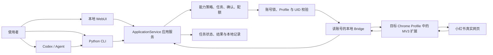
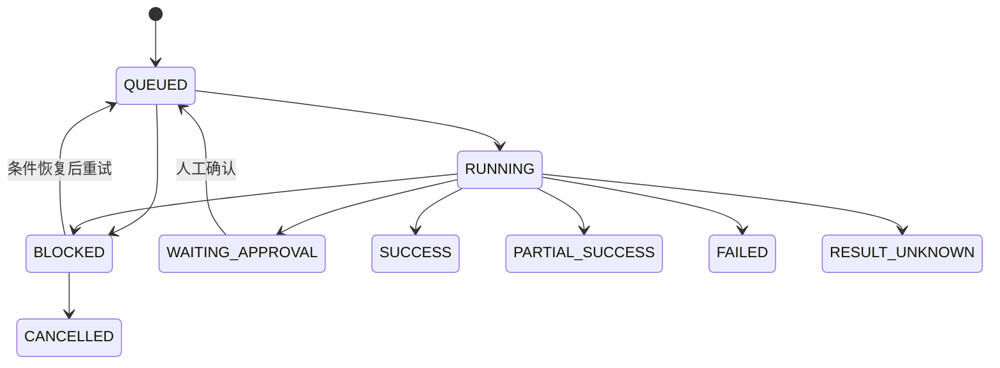

# auto-xhs 新手项目说明

适用对象：第一次接触本项目的使用者、运营人员和开发者
审阅基线：2026-08-24 当前工作区
项目环境：Windows 10/11、Google Chrome、Python 3.11+

## 1. 先用一分钟理解这个项目

`auto-xhs` 是一套运行在自己电脑上的多账号小红书运营工具。它不依赖云端服务器保存账号，
也不是小红书官方 API 客户端。项目通过已经登录的小红书 Chrome Profile 操作真实网页，并用
本地 WebUI、Codex/Agent 和 Python CLI 提供三种使用入口。

可以把它理解成一座本地“运营中转站”：

```text
你提出任务
→ 项目确认使用哪个账号
→ 检查这个账号对应的 Chrome Profile、扩展和登录 UID
→ 在浏览器中读取页面或执行明确操作
→ 回读页面结果
→ 把任务状态、结果和异常保存在本机
```

它重点解决五个问题：

1. 多个小红书账号怎样绑定到不同 Chrome Profile，避免串号；
2. 普通用户怎样通过 WebUI 使用项目，而不必记住大量命令；
3. Codex/Agent 怎样把自然语言要求转换成稳定的已有能力；
4. 评论、私信、发布等外发操作怎样保留预览、确认和结果回读；
5. 执行失败或结果不确定时，怎样留下可恢复、可审计的本地记录。

## 2. 它不是什么

理解边界比记住功能更重要：

- 它不是小红书官方开放平台，也不保证网页结构永远不变；
- 它不是把 Cookie 上传到云端的账号托管服务；
- 它不会绕过验证码、登录确认或平台限制；
- 它不是任意网页都能自主操作的通用浏览器机器人；
- 它不会因为模型给出高置信度，就在后台自动发送评论或私信；
- “代码已实现”“自动化测试通过”和“真实账号已验收”是三种不同状态。

## 3. 整体架构

### 3.1 从入口到网页的完整链路



这条链路的核心思想是：所有入口尽量复用同一应用服务和同一能力策略。WebUI 不是另一套业务
实现，Codex 也不应临时绕开项目写一套新的浏览器脚本。

### 3.2 每一层分别做什么

| 层 | 新手可以怎样理解 | 主要位置 |
|---|---|---|
| WebUI | 图形化本地控制台，适合配置账号、创建常用任务、确认草稿和查看结果 | `webui/`、`scripts/web_server.py` |
| Codex/Agent | 理解自然语言，选择合适的 Skill 和 CLI 命令，适合多步骤运营任务 | `SKILL.md`、`skills/` |
| Python CLI | 项目的标准命令入口，也是测试和高级诊断入口 | `scripts/cli.py` |
| 应用服务 | 统一处理账号、任务、草稿、确认、执行和记录 | `scripts/application_service.py` |
| 能力策略 | 说明每个命令的风险等级、确认、身份校验和重试规则 | `scripts/capability_registry.py` |
| 账号运行层 | 管理账号槽位、Profile、Bridge 端口、配对和任务锁 | `scripts/account_*.py`、`scripts/run_lock.py` |
| Bridge | 本机 WebSocket 中转站，把 CLI 请求交给正确的浏览器扩展 | `scripts/bridge_server.py` |
| Chrome 扩展 | 在目标 Profile 中导航、读取页面、输入、点击并返回结果 | `extension/` |
| 页面适配器 | 针对搜索、详情、评论、私信、发布等页面组织具体步骤 | `scripts/xhs/` |
| 本地数据层 | 保存任务、草稿、入站事件、指标、规则和执行记录 | `scripts/product_store.py`、`scripts/operations_db.py` |

## 4. 三种使用入口怎样选择

### 4.1 WebUI：普通用户的首选入口

双击项目根目录的 `start-auto-xhs.cmd` 后，系统会准备项目虚拟环境、启动本地服务，并打开：

```text
http://127.0.0.1:8765
```

WebUI 只监听本机地址，当前分为六个区域：

| 区域 | 用途 |
|---|---|
| 今日总览 | 查看异常账号、待确认事项、近期失败和系统概况 |
| 账号 | 添加槽位、绑定 Profile、启动账号、配对扩展、确认 UID |
| 任务 | 创建浏览、搜索、详情、首页互动、随机评论等常用任务 |
| 确认中心 | 核对发布预览、评论/回复草稿和收到的新私信回复 |
| 执行记录 | 查看成功、失败、阻塞和结果未知的历史任务 |
| 系统 | 全局暂停、并发、模型设置、运行状态和脱敏诊断 |

### 4.2 Codex/Agent：自然语言和复合任务入口

适合以下表达：

```text
使用 brand-a 搜索“露营装备”，只读取前 10 条并总结标题规律。

使用 shop-1 浏览首页 6 篇，其中点赞 2 篇，不要评论。

为 brand-a 收到的新评论生成回复草稿，先给我确认，不要自动发送。
```

Agent 的职责是把要求路由到现有 Skill 和 CLI。例如：

```text
自然语言要求
→ xiaohongshu-skills 判断子技能
→ 选择 scripts/cli.py 的已有子命令
→ CLI 和应用服务执行统一检查
→ 返回结构化结果
```

自然语言中最好明确三项：使用哪个账号、要操作什么目标、是否只读或允许外发。

### 4.3 Python CLI：开发、诊断和精确执行入口

多账号命令的标准形式是：

```powershell
python scripts/cli.py --account <账号槽位> <子命令> [参数]
```

注意 `--account` 位于子命令前面。账号管理类命令有时使用自己的 `--name` 参数，例如：

```powershell
python scripts/cli.py account-doctor --name brand-a --require-ready
```

完整命令以以下输出为准：

```powershell
python scripts/cli.py --help
python scripts/cli.py <子命令> --help
```

## 5. 最重要的核心概念

### 5.1 账号槽位不是小红书账号本身

账号槽位是项目在本机创建的一条固定运行线路。一个槽位主要关联：

```text
槽位名称
+ Chrome User Data 目录
+ Chrome Profile 目录
+ 独立 Bridge 端口
+ 扩展配对身份
+ 已确认的小红书 UID
+ 独立任务锁
```

例如 `brand-a` 只是本机别名，不是手机号或小红书号。真正的登录状态仍在它绑定的 Chrome
Profile 中。

### 5.2 Chrome Profile 是登录状态的载体

项目优先复用用户已经登录的 Chrome Profile。每个 Profile 有自己的 Cookie、页面状态和扩展
本地存储，因此不同账号不能随意共用同一个 Profile。

项目可以在扩展离线时按配置打开绑定的 Profile，但不会任意切换或关闭用户的 Chrome。账号是否
真正可用，仍然要以 Profile、扩展实例和当前 UID 的回读为准。

### 5.3 通用扩展是一份代码、多个独立实例

所有 Profile 可以加载项目根目录下同一份 `extension/` 代码。每个 Profile 中的扩展实例会把
自己的配对信息保存在 `chrome.storage.local`，因此“扩展目录相同”不等于“账号身份相同”。

### 5.4 Bridge 是本地转发器

Bridge 监听本机 WebSocket 端口。默认第一个槽位从 `9333` 开始，后续槽位自动选择可用端口。
它同时接收两类连接：

- Chrome 扩展保持长连接，等待浏览器操作请求；
- CLI 建立短连接，发送一次业务命令并等待结果。

Bridge 会核对账号连接 ID、连接令牌、扩展实例和 Profile 声明，避免把任务发给错误账号。

### 5.5 READY 是“可以执行任务”的最终状态

仅仅看到 Python 进程或 Bridge 端口在线，不代表账号已经可用。一个槽位要依次通过：

```text
Bridge 在线
→ 扩展已连接
→ Profile 与槽位一致
→ 当前登录 UID 已读取
→ 当前 UID 与槽位记录一致
→ READY
```

如果其中任何一项不满足，WebUI 会把账号标记为需要处理，并给出下一步动作。

## 6. 项目怎样防止多账号串号

不同账号分别拥有 Profile、Bridge 端口、扩展实例、UID 基准和任务锁。执行外部操作前，应用服务
会检查目标槽位与当前浏览器身份是否一致。

并发规则是：

- 不同账号可以并行，默认全局并发上限为 3；
- 同一账号同一时间只执行一个任务；
- 一个账号正在运行或等待确认时，不为它重复创建冲突任务；
- 如果当前 UID 与槽位记录不一致，外部操作停止，不自动覆盖原身份。

## 7. 能力和操作等级

项目把能力分为四级。这里的等级是产品执行规则，不是论文式风险评分。

| 等级 | 含义 | 常见例子 | 基本规则 |
|---|---|---|---|
| L0 | 只读 | 搜索、详情、主页、账号诊断、评论/私信采集 | 可以安全读取，仍需目标账号 |
| L1 | 改变平台状态 | 点赞、收藏、关注 | 核验 UID、限制重试、保存结果 |
| L2 | 对外输出 | 评论、回复、私信、发布 | 明确目标和文本，保留确认或单次授权，不自动重发 |
| L3 | 本地安全配置 | 添加账号、配对、换号、记录 UID | 明确操作范围并验证结果 |

### 7.1 当前主要能力

| 分类 | 已有能力 |
|---|---|
| 账号管理 | 新建/导入槽位、发现 Profile、启动账号、扩展配对、状态诊断、UID 核验、半自动换号、归档槽位 |
| 内容发现 | 首页推荐、自动浏览、关键词搜索、笔记详情、评论、用户主页 |
| 互动 | 点赞、收藏、关键词随机互动、随机评论、首页浏览+点赞、Agent 上下文评论、关注博主 |
| 发布 | 图文、视频和长文的填写、真实浏览器预览、人工确认发布或保存草稿 |
| 私信 | 主动首次/续发私信批次，以及收到新私信后的只读采集、AI 草稿和人工确认链 |
| 智能回复 | 评论和入站私信上下文、账号人格/知识、模型草稿、质量提示、人工确认 |
| 数据与诊断 | 入站事件、操作记录、指标快照、404/风控诊断、脱敏诊断导出 |

能力是否适合真实账号使用，需继续看 [PRD 追踪矩阵](PRD-TRACEABILITY.md)。自动化测试通过不自动
代表已经完成真实账号验收。

## 8. 任务、草稿和结果怎样流转

### 8.1 普通任务状态



| 状态 | 新手解释 | 应对方式 |
|---|---|---|
| `QUEUED` | 已创建，等待执行 | 等待或检查是否有同账号任务占用 |
| `RUNNING` | 正在浏览器中执行 | 不要关闭目标 Profile |
| `WAITING_APPROVAL` | 等待人工核对 | 在确认中心检查账号、目标、内容和预览 |
| `SUCCESS` | 已得到明确成功回读 | 查看记录即可 |
| `PARTIAL_SUCCESS` | 批次中一部分成功 | 查看逐项结果，不要整体重跑 |
| `BLOCKED` | 执行条件不满足 | 按 `recommended_action` 恢复后再重试 |
| `FAILED` | 已得到明确失败结果 | 修复参数、页面或连接问题 |
| `RESULT_UNKNOWN` | 可能已经执行，但回读不足 | 先到平台人工核对，不能直接重发 |
| `CANCELLED` | 任务已取消 | 不再执行 |

### 8.2 发布为什么分成多个步骤

发布不是一步命令直接完成，而是：

```text
Agent/CLI 填写发布页
→ 浏览器进入最终预览
→ 任务进入 WAITING_APPROVAL
→ WebUI 展示账号、UID、标题、正文、素材和定时时间
→ 用户确认已检查真实预览
→ 点击发布，或取消并保存草稿
→ 页面回读最终结果
```

`fill-publish` 成功只代表表单和预览已经准备好，不代表内容已经发布。

### 8.3 智能回复为什么不会直接发送

评论和收到的新私信先保存为入站事件，然后模型生成本地草稿：

```text
读取新评论或新私信
→ 保存并去重入站事件
→ 组装笔记/评论或近期私信上下文
→ 模型生成结构化草稿
→ 人工核对和修改
→ 进入现有评论、回复或私信发送链
→ 回读结果
```

模型配置缺失时会返回 `LLM_NOT_CONFIGURED`，不会用固定模板假装成模型结果。

## 9. 第一次使用：从零到 READY

### 第 1 步：准备环境

需要：

- Windows 10 或 Windows 11；
- Google Chrome；
- Python 3.11 或更高版本；
- 一个已经登录小红书的 Chrome Profile；
- 当前项目目录。

### 第 2 步：启动本地控制台

在项目根目录双击：

```text
start-auto-xhs.cmd
```

启动器会创建或复用 `.venv`，安装项目依赖，启动本地 WebUI，并打开浏览器。如果提示缺少 Python，
按提示确认后再执行项目提供的准备命令，不要反复安装多个 Python。

### 第 3 步：添加账号槽位

在 WebUI 的“账号”页点击“添加账号”。新手推荐选择“绑定已有 Chrome Profile”：

1. 点击扫描 Profile；
2. 选择实际已经登录目标小红书账号的 Profile；
3. 确认槽位名称；
4. 添加并开始配置。

先只添加一个账号，完整走通后再添加其他账号。

### 第 4 步：在目标 Profile 加载扩展

使用目标 Chrome Profile 打开：

```text
chrome://extensions/
```

打开“开发者模式”，选择“加载已解压的扩展程序”，加载当前项目的：

```text
<项目根目录>\extension
```

同一份扩展代码要在每个目标 Profile 中分别加载和配对。

### 第 5 步：启动账号并完成配对

回到 WebUI：

1. 点击目标账号的“启动账号”；
2. 系统启动或复用该槽位的 Bridge；
3. 发起配对并复制一次性配对信息；
4. 打开目标 Profile 中的扩展弹窗；
5. 粘贴配对信息并确认；
6. 回到 WebUI 刷新。

配对信息有时效且只能使用一次。不要把一个槽位的配对信息粘贴到另一个 Profile。

### 第 6 步：检查并确认 UID

扩展连接后，使用 WebUI 的身份检查。确认显示的昵称和 UID 确实属于目标账号，再记录为槽位身份
基准。如果结果不一致，先检查是否打开了错误 Profile。

### 第 7 步：先做只读冒烟测试

账号显示 READY 后，先运行不会改变平台状态的命令：

```powershell
python scripts/cli.py account-doctor --name brand-a --require-ready

python scripts/cli.py --account brand-a check-login

python scripts/cli.py --account brand-a search-feeds --keyword "露营装备"
```

只读链路稳定后，再尝试点赞、收藏、评论、私信或发布。

## 10. 日常使用建议

每天开始时：

```text
双击启动 WebUI
→ 在账号页启动需要使用的槽位
→ 确认账号进入 READY
→ 先处理 BLOCKED 和待确认任务
→ 再创建新任务
```

每天结束时：

- 确认没有遗留的 `WAITING_APPROVAL` 或 `RUNNING` 任务；
- 查看 `RESULT_UNKNOWN`，到真实页面核对是否已经执行；
- WebUI 页面可以关闭，但关闭页面不等于停止 Bridge；
- 不要在任务执行时随意结束未知 Python 或 Chrome 进程。

## 11. 常用命令速查

### 账号与诊断

```powershell
# 列出槽位
python scripts/cli.py account-list

# 只读诊断全部账号
python scripts/cli.py account-doctor

# 要求一个槽位达到 READY
python scripts/cli.py account-doctor --name brand-a --require-ready

# 启动或恢复目标账号
python scripts/cli.py --account brand-a account-start

# 查看配对和扩展连接
python scripts/cli.py --account brand-a account-pair-status
```

### 内容读取

```powershell
python scripts/cli.py --account brand-a list-feeds

python scripts/cli.py --account brand-a search-feeds --keyword "关键词"

python scripts/cli.py --account brand-a get-feed-detail `
  --feed-id FEED_ID --xsec-token XSEC_TOKEN

python scripts/cli.py --account brand-a user-profile `
  --user-id USER_ID --xsec-token XSEC_TOKEN
```

### 评论与私信事件

```powershell
# 只读回收自己笔记的新评论
python scripts/cli.py --account brand-a collect-note-comments --max-notes 20

# 只读回收最近一对一私信中的对方最新文字
python scripts/cli.py --account brand-a collect-private-messages --max-conversations 20

# 为一个明确事件生成本地待确认草稿
python scripts/cli.py --account brand-a generate-reply-draft `
  --event-id EVENT_ID --verified-uid CURRENT_VERIFIED_UID
```

更完整的命令和参数见根目录 [README](../README.md) 和 [用户指南](USER-GUIDE.md)。

## 12. 本地数据保存在哪里

默认位置：

```text
账号槽位：%USERPROFILE%\.xhs\accounts
任务、草稿和诊断：%USERPROFILE%\.xhs\auto-xhs
Chrome 登录状态：各自绑定的 Chrome Profile
扩展源码：<项目根目录>\extension
```

其中：

- `product-state.json` 保存任务、草稿、确认、事件和部分设置；
- `operations.db` 保存入站事件、采集游标、操作事件、回复规则、指标快照和动作草稿；
- 账号目录保存槽位配置、Bridge 信息和 Profile 关联；
- 删除项目目录不会自动删除 `%USERPROFILE%\.xhs` 下的本地数据；
- 这些目录以及 Chrome Profile 不应提交到 GitHub。

## 13. 项目目录导览

```text
xiaohongshu-skills/
├── README.md                   项目首页、安装和完整命令参考
├── SKILL.md                    Agent 总路由和最高级执行边界
├── start-auto-xhs.cmd          Windows 一键启动入口
├── pyproject.toml              Python 版本、依赖、pytest 和 Ruff 配置
├── scripts/
│   ├── cli.py                  标准 CLI 入口
│   ├── application_service.py  WebUI/CLI 共用的应用服务
│   ├── capability_registry.py  能力等级、确认和重试策略
│   ├── account_*.py            账号槽位、身份、配对和生命周期
│   ├── bridge_server.py        CLI 与扩展之间的 WebSocket Bridge
│   ├── product_store.py        JSON 任务与草稿存储
│   ├── operations_db.py        SQLite 事件与指标存储
│   └── xhs/                    小红书各页面适配器
├── extension/                  Manifest V3 Chrome 扩展
├── webui/                      本地工作台前端
├── prompts/                    评论和私信智能回复提示词
├── skills/                     认证、发现、互动、发布和运营子技能
├── tests/                      自动化测试
└── docs/                       PRD、指南、架构、故障和验收文档
```

### 新开发者先读哪些文件

建议顺序：

1. 本文，先理解系统全貌；
2. [PRD](PRD.md)，理解版本规则和产品边界；
3. 根目录 [SKILL.md](../SKILL.md)，理解 Agent 路由和操作约束；
4. `scripts/capability_registry.py`，看哪些命令开放以及怎样确认；
5. `scripts/application_service.py`，看入口怎样调用业务服务；
6. `scripts/business_runner.py` 和 `scripts/xhs/`，看能力怎样落到浏览器页面；
7. `scripts/bridge_server.py` 与 `extension/background.js`，理解浏览器通信；
8. 对应测试文件，确认真实代码契约。

## 14. 开发者怎样运行和验证

### 准备开发环境

```powershell
powershell -ExecutionPolicy Bypass -File scripts/bootstrap.ps1 -Prepare
```

### 启动 WebUI

```powershell
.\.venv\Scripts\python.exe scripts\web_server.py --host 127.0.0.1 --port 8765
```

日常更推荐双击 `start-auto-xhs.cmd`，它会复用已经运行的服务并打开浏览器。

### 运行测试和静态检查

```powershell
.\.venv\Scripts\python.exe -m pytest -q
.\.venv\Scripts\python.exe -m ruff check .
```

开发新能力时，至少同时检查：

```text
CLI 是否注册命令
→ capability_registry 是否有策略
→ ApplicationService 是否复用统一检查
→ BusinessRunner / xhs 适配器是否实现
→ WebUI 是否只开放允许的入口
→ 是否有对应自动化测试
→ 文档是否区分代码、测试和真实账号验收
```

## 15. 常见问题的判断顺序

### WebUI 打不开

1. 再次双击 `start-auto-xhs.cmd`；
2. 检查是否缺少 Python 3.11+；
3. 用 `scripts/bootstrap.ps1 -Prepare` 修复项目 `.venv`；
4. 确认 8765 端口没有被其他程序占用。

### 账号不是 READY

按这个顺序看：

```text
Bridge 是否在线
→ 扩展是否连接
→ 扩展是否配对到正确槽位
→ 是否打开正确 Profile
→ 小红书是否登录
→ 当前 UID 是否与槽位记录一致
```

优先运行只读诊断：

```powershell
python scripts/cli.py account-doctor --name brand-a --require-ready
```

### 任务进入 BLOCKED

查看任务中的 `recommended_action`。恢复账号后再重试，不要在连接条件没有恢复时连续点击。

### 任务进入 RESULT_UNKNOWN

这表示系统无法可靠确认最终平台状态。先打开真实页面检查是否已经点赞、评论、发信或发布，再决定
下一步。直接重试可能造成重复操作。

### 模型草稿无法生成

在 WebUI“系统”中检查智能回复模型配置和连接测试。`LLM_NOT_CONFIGURED` 表示缺少接口地址、模型
名称或 API Key；这不会影响普通搜索、浏览和手工草稿功能。

更完整的恢复方法见 [故障恢复指南](TROUBLESHOOTING.md)。

## 16. 版本关系怎样理解

| 版本 | 含义 |
|---|---|
| V1.0 | 冻结的基础产品合同，重点是本地多账号、热登录 Profile、基础读取与受控互动 |
| V1.5 | 分批交付的增量能力，包括账号联合启动、分步发布、主动私信、主加和更完整的运营闭环 |
| V2.0 | 评论和入站私信智能回复，强调上下文、模型草稿、人工确认和结果回读 |

看到“V1.5 目标”时，不要自动理解成真实账号已经验收。当前状态应同时核对：

- [PRD](PRD.md)：产品规则；
- [需求追踪矩阵](PRD-TRACEABILITY.md)：实现、测试和实机状态；
- [V2.0 智能回复](AUTO-XHS-V2-INTELLIGENT-REPLY.md)：模型和回复链；
- [闭环架构](AUTO-XHS-CLOSED-LOOP-ARCHITECTURE.md)：任务、事件、私信和指标设计。

## 17. 新手常见术语

| 术语 | 含义 |
|---|---|
| 槽位 / slot | 项目内的账号运行别名和配置容器 |
| Profile | Chrome 中独立保存登录状态和扩展数据的用户环境 |
| Bridge | CLI 与浏览器扩展之间的本地 WebSocket 中转服务 |
| MV3 | Chrome 扩展使用的 Manifest V3 规范 |
| UID | 用来确认当前登录小红书身份的账号标识 |
| XSEC Token | 小红书网页链接或结果中与目标内容访问相关的临时参数 |
| READY | Bridge、扩展、Profile 和 UID 均通过检查，可执行任务 |
| 入站事件 | 从平台读取到的新评论或新私信，尚不等于已创建外发任务 |
| 草稿 | 保存在本机、尚未向平台发送的内容 |
| 回读 | 操作后重新读取页面，确认真实状态是否发生变化 |
| RESULT_UNKNOWN | 请求可能已执行，但回读不足，必须人工核对 |

## 18. 最短学习路线

如果你只想使用项目：

```text
读第 1、4、5、9、10、15 节
→ 添加一个账号并进入 READY
→ 完成一次只读搜索
→ 学会查看 BLOCKED 和 RESULT_UNKNOWN
→ 再尝试受控互动
```

如果你需要继续开发：

```text
读完整本文
→ 阅读 PRD 和根 SKILL.md
→ 跟踪一次 search-feeds 的完整调用链
→ 跟踪一次需要确认的评论或发布任务
→ 阅读对应测试
→ 修改后运行 pytest 和 Ruff
```

第一次理解项目时，不需要逐行阅读两千多行的 WebUI 或 ApplicationService。先抓住四条主线即可：

```text
账号槽位与身份
任务与确认
Bridge 与扩展
结果回读与本地记录
```

这四条主线理解以后，其他文件基本都能找到自己的位置。
